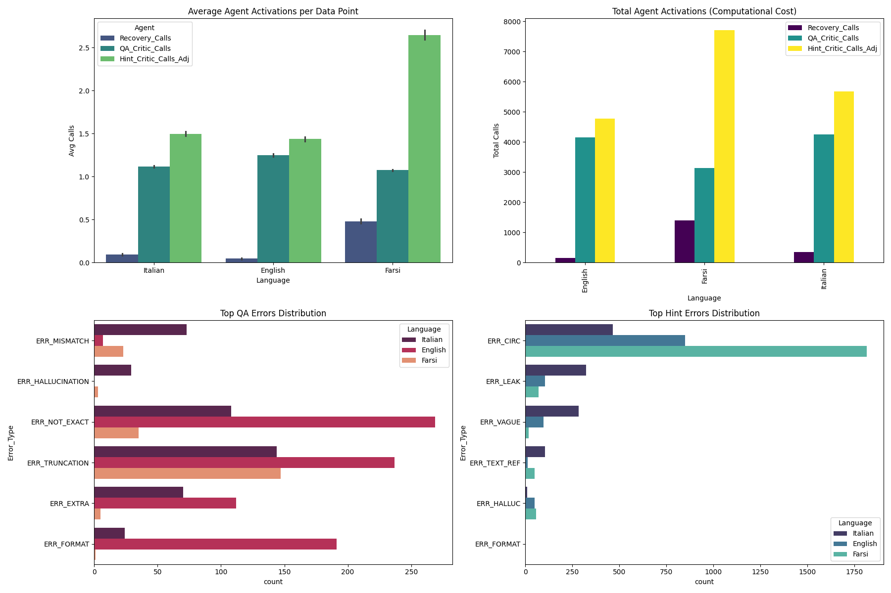

# MultiHint-9K: Orchestrating Human and AI Agency for Scalable Pedagogical Hint Generation

<div align="center">

[](https://ceur-ws.org/Vol-4248/short11.pdf)
[](https://huggingface.co/datasets/Kamyar-zeinalipour/MultiHint-9K)
[](https://huggingface.co/collections/Kamyar-zeinalipour/multihint-9k-aied-2026-6af4875966cf330a922a1d87)
[](LICENSE)
[](https://github.com/KamyarZeinalipour/MultiHint-9K)

</div>

---

## 📖 Overview

**MultiHint-9K** is a multilingual dataset and pipeline for scalable, high-quality pedagogical Socratic hint generation. Large Language Models frequently fail at pedagogical scaffolding — leaking answers or producing circular reasoning. We introduce a **human-AI agency framework** that combines:

- 🧠 **Human calibration** — annotators define quality standards once at the meta-level
- 🤖 **AI enforcement at scale** — adversarial agent pipeline generates, critiques, refines, and recovers hints autonomously

The result: **9,987 machine-verified, human-calibrated QA-Hint tuples** across **English, Italian, and Farsi**.



---

## 📊 Dataset Statistics

| Language | Articles | Tuples | Yield |
|----------|----------|--------|-------|
| English  | 3,421    | 3,327  | 97.2% |
| Italian  | 3,800    | 3,793  | 99.8% |
| Farsi    | 3,017    | 2,867  | 95.0% |
| **Total**| **10,238**| **9,987** | **97.5%** |

The adversarial pipeline flagged **5,743 errors** including:
- 🔴 3,131 circular reasoning instances
- 🟠 495 answer leakage instances
- 🟡 1,617 vagueness/hallucination instances

---

## 🚀 Quick Start

### Installation

```bash
git clone https://github.com/KamyarZeinalipour/MultiHint-9K.git
cd MultiHint-9K
pip install -r requirements.txt
```

### Load the Dataset

```python
from datasets import load_dataset

# Full dataset
dataset = load_dataset("Kamyar-zeinalipour/MultiHint-9K")

# Per-language
en_data = load_dataset("Kamyar-zeinalipour/MultiHint-9K", split="train").filter(
    lambda x: x["language"] == "English"
)
```

### Use a Fine-Tuned Model

```python
from transformers import AutoModelForCausalLM, AutoTokenizer
from peft import PeftModel

base_model = "mistralai/Mistral-Nemo-Instruct-2407"
adapter = "Kamyar-zeinalipour/MultiHint-9K-Nemo-12B"

tokenizer = AutoTokenizer.from_pretrained(base_model)
model = AutoModelForCausalLM.from_pretrained(base_model)
model = PeftModel.from_pretrained(model, adapter)

# Format: passage + question + answer → hint
prompt = """You are a Recall Assistant. Provide a succinct Socratic hint for the question based on the passage.

Passage: {passage}
Question: {question}
Answer: {answer}
Hint:"""

inputs = tokenizer(prompt.format(
    passage="The Eiffel Tower was built between 1887 and 1889 as the entrance arch for the 1889 World's Fair.",
    question="What was the original purpose of the Eiffel Tower?",
    answer="Entrance arch for the 1889 World's Fair"
), return_tensors="pt")

output = model.generate(**inputs, max_new_tokens=100)
print(tokenizer.decode(output[0], skip_special_tokens=True))
```

---

## 🏗️ Pipeline Architecture

```
Wikipedia Corpus
      │
      ▼
┌─────────────────────────────────────────────┐
│           PHASE 1: QA Generation            │
│  Generator → QA Critic → QA Refiner (×N)   │
└─────────────────────────────────────────────┘
      │  Valid QA Pair
      ▼
┌─────────────────────────────────────────────┐
│         PHASE 2: Hint Scaffolding           │
│  Hint Architect → Hint Critic → Hint        │
│  Refiner (×N) → Recovery Agent             │
└─────────────────────────────────────────────┘
      │  Verified QA-Hint Tuple
      ▼
   MultiHint-9K Dataset
```

### Agent Configuration

| Language | QA Generator | Hint Architect | Hint Critic |
|----------|-------------|----------------|-------------|
| English  | Gemini-1.5-Flash | GPT-4o | Gemini-1.5-Flash |
| Italian  | Mistral-Large | DeepSeek-Chat | GPT-4o |
| Farsi    | Gemini-1.5-Flash | DeepSeek-Chat | DeepSeek-Chat |

### Run the Pipeline

```bash
cd pipeline

# Configure API keys
cp .env.example .env
# Edit .env with your API keys

# Run pipeline
python pipeline_orchestrator.py
```

---

## 🎯 Fine-Tuning

We fine-tune 5 open-source models (7B–24B) via LoRA on MultiHint-9K.

### Training

```bash
cd training

# Configure API keys / dataset
# Edit run_training.sh if needed

# Launch training (4×A6000 GPUs)
bash run_training.sh
```

**Training configuration:**
- LoRA: `r=32, alpha=64, dropout=0.1`
- Targets: `q_proj, k_proj, v_proj, o_proj, down_proj, up_proj, gate_proj`
- Epochs: 3, LR: 1e-4 (cosine), Batch: 4×4 with grad. accum. 2
- Mixed precision: bf16, Flash Attention 2

### Models

Released as LoRA adapters in the [MultiHint-9K collection](https://huggingface.co/collections/Kamyar-zeinalipour/multihint-9k-aied-2026-6af4875966cf330a922a1d87):

| Base model | Adapter | ROUGE-L (base → fine-tuned) |
|---|---|---|
| [Llama-3.1-8B](https://huggingface.co/meta-llama/Llama-3.1-8B-Instruct) | [MultiHint-9K-Llama-3.1-8B](https://huggingface.co/Kamyar-zeinalipour/MultiHint-9K-Llama-3.1-8B) | 0.20 → **0.32** (+52%) |
| [Qwen2.5-14B](https://huggingface.co/Qwen/Qwen2.5-14B-Instruct) | [MultiHint-9K-Qwen2.5-14B](https://huggingface.co/Kamyar-zeinalipour/MultiHint-9K-Qwen2.5-14B) | 0.23 → **0.31** (+34%) |
| [Mistral-7B-v0.3](https://huggingface.co/mistralai/Mistral-7B-Instruct-v0.3) | [MultiHint-9K-Mistral-7B-v0.3](https://huggingface.co/Kamyar-zeinalipour/MultiHint-9K-Mistral-7B-v0.3) | 0.19 → **0.32** (+57%) |
| [Mistral-Nemo-12B](https://huggingface.co/mistralai/Mistral-Nemo-Instruct-2407) | [MultiHint-9K-Nemo-12B](https://huggingface.co/Kamyar-zeinalipour/MultiHint-9K-Nemo-12B) | 0.15 → **0.31** (+100%) |
| [Mistral-Small-24B](https://huggingface.co/mistralai/Mistral-Small-24B-Instruct-2501) | [MultiHint-9K-Mistral-Small-24B](https://huggingface.co/Kamyar-zeinalipour/MultiHint-9K-Mistral-Small-24B) | 0.18 → **0.33** (+71%) |

All improvements statistically significant (*p* < 0.001, Bonferroni-corrected Wilcoxon).

### Evaluation

```bash
cd training
python eval.py \
  --model_path outputs/mistralai_Mistral-Nemo-Instruct-2407_frac1_hint_32_64 \
  --test_data ../data/samples/sample_en.csv \
  --output_file results.csv
```

---

## 📁 Repository Structure

```
MultiHint-9K/
├── README.md
├── LICENSE
├── requirements.txt
├── .gitignore
│
├── paper/
│   └── MultiHint-9K_AIED2026.pdf      # Camera-ready paper
│
├── pipeline/                            # Data generation pipeline
│   ├── pipeline_orchestrator.py         # Main orchestration logic
│   ├── models_apis.py                   # LLM API wrappers
│   └── prompts_config.py                # All system prompts
│
├── training/                            # Fine-tuning code
│   ├── train.py                         # SFT training script
│   ├── eval.py                          # Evaluation (ROUGE-L, BERTScore)
│   ├── inference.py                     # Inference with LoRA adapters
│   ├── utils.py                         # Model/dataset utilities
│   ├── run_training.sh                  # Training launch script
│   └── configs/
│       ├── deepspeed_config.yaml        # DeepSpeed ZeRO-2
│       ├── deepspeed_zeropp_lora_config.yaml
│       └── fsdp_config.yaml
│
├── data/
│   └── samples/                         # Representative data samples
│       ├── sample_en.csv                # English samples
│       ├── sample_it.csv                # Italian samples
│       └── sample_fa.csv                # Farsi samples
│
└── assets/
    └── agent_analysis_and_errors.png    # Error analysis figure
```

---

## 📋 Data Format

Each row in MultiHint-9K contains:

```python
{
    "language":     "English",                    # English | Italian | Farsi
    "passage":      "The Eiffel Tower was...",    # Source Wikipedia passage
    "question":     "What was the purpose of...", # Generated QA question
    "answer":       "Entrance arch...",           # Generated answer
    "hint":         "Think about what major...",  # Verified Socratic hint
    "messages":     [...],                        # Chat-formatted for SFT
    "token_count":  312                           # Token count
}
```

Sample data → [`data/samples/`](data/samples/)  
Full dataset → [🤗 HuggingFace Hub](https://huggingface.co/datasets/Kamyar-zeinalipour/MultiHint-9K)

---

## 📈 Component Contribution Analysis

| Pipeline Configuration | Est. Yield | Error Risk |
|-----------------------|-----------|-----------|
| Generator only (no Critic) | 98.0% | ⚠️ 33.1% erroneous hints |
| Generator + Critic (no Refiner) | 37.7% | ✅ Low errors, 62% waste |
| Gen + Critic + Refiner (no Recovery) | 82.2% | ✅ Low errors, moderate waste |
| **Full Pipeline** | **98.0%** | ✅ **Only 2.5% discarded** |

---

## 🌐 Environment Setup

Create a `.env` file in `pipeline/`:

```bash
# pipeline/.env
OPENAI_API_KEY=your_openai_key
DEEPSEEK_API_KEY=your_deepseek_key
GEMINI_API_KEY=your_gemini_key
MISTRAL_API_KEY=your_mistral_key
```

---

## 📄 Citation

If you use MultiHint-9K in your research, please cite:

```bibtex
@inproceedings{zeinalipour2026multihint,
  title     = {MultiHint-9K: Orchestrating Human and {AI} Agency for Scalable Pedagogical Hint Generation},
  author    = {Zeinalipour, Kamyar and Sadeghi, Amir and Angelini, Giovanni and
               Rigutini, Leonardo and Gori, Marco and Maggini, Marco},
  booktitle = {Proceedings of the Workshop on Orchestrating Human and AI Agency for
               Proactive and Reflective Learning ({HAI-Agency@AIED} 2026)},
  year      = {2026}
}
```

---

## 👥 Authors

| Name | Institution | Contact |
|------|-------------|---------|
| Kamyar Zeinalipour | University of Siena | Kamyar.zeinalipour@student.unisi.it |
| Amir Sadeghi | University of Siena | a.sadeghi@student.unisi.it |
| Giovanni Angelini | Expert.ai | postapergio@gmail.com |
| Leonardo Rigutini | Expert.ai | lrigutini@expert.ai |
| Marco Gori | University of Siena | marco.gori@unisi.it |
| Marco Maggini | University of Siena | marco.maggini@unisi.it |

---

## 📜 Related Work

- [Clue-Instruct](https://arxiv.org/abs/2404.06186) — Educational crossword clue generation (LREC-COLING 2024)
- [Turkish Quiz Generation](https://doi.org/10.1007/978-3-031-82150-9_19) — Multilingual QA generation (ISPR 2024)
- [Italian Crossword Generator](https://arxiv.org/abs/2311.15723) — Italian educational puzzles
- [Arabic Crossword Puzzles](https://aclanthology.org/) — LLM-driven Arabic educational crosswords (WLLRL 2025)

---

<div align="center">
<b>⭐ If you find this useful, please star the repository! ⭐</b>
</div>
